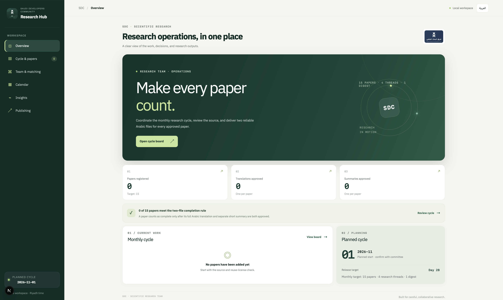
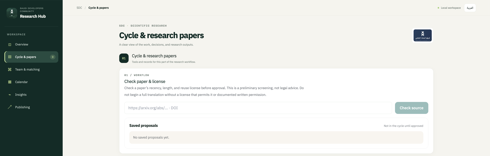
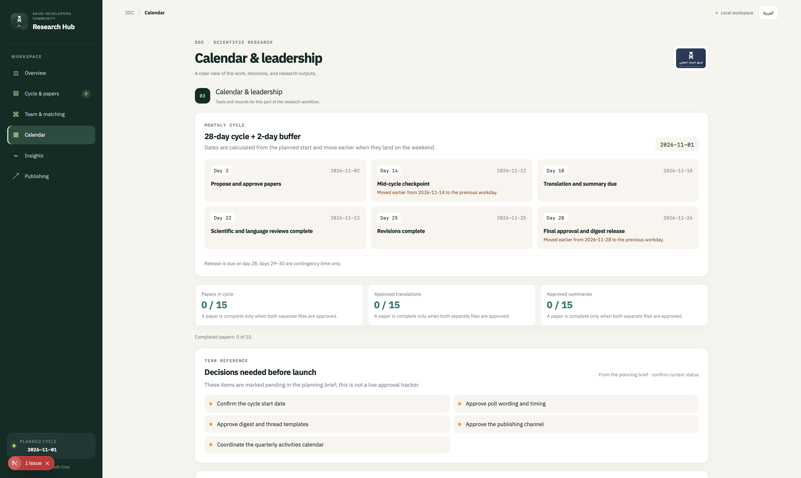

# SDC Research Hub

Arabic-first, RTL, offline-capable workspace for the Saudi Developers Community (SDC) Scientific Research team. It manages a monthly cycle of 15 research papers, with a separate Arabic translation and short Arabic summary for every paper.

## Why this exists

Every month, the SDC Scientific Research team translates and summarizes AI research papers into Arabic. Doing that across 15 papers and a 50-person volunteer team means tracking licenses, deadlines, reviews, and approvals. This tool turns that workflow into one Arabic-first workspace. I built it with Codex, milestone by milestone, and published it as an open-source example of working with Codex on a real project.

## Screenshots

All screenshots use invented demo data.








## What works

- Arabic default layout with RTL support and an English toggle across the workflow screens.
- Two modes: `APP_MODE=private` (empty by default, loads members from an ignored `private/members.csv` into local SQLite) and `APP_MODE=demo` (invented records only, intended for local review and testing).
- Cycle calendar with Sunday-Thursday deadline shifting, per-deliverable status, completion rules, and escalation.
- Paper Gate using OpenAlex first and arXiv as a fallback, with recency, size, and license verdicts.
- Cycle milestones, planning-brief decisions, annual themes, KPIs, team matching, paper eligibility screening, a saved proposal list, and a Markdown report based only on tracked records.
- Offline demo data and mock-only AI behavior; no external LLM call is made by the application.
- SDC and Scientific Research team branding is included in the application shell from the supplied project assets. The branding remains the property of the Saudi Developers Community.

## Quick start

Requires Node.js 22 or newer (the app uses the built-in `node:sqlite` module).

```bash
npm install
cp .env.example .env.local
npm run dev
```

Open [http://localhost:3000](http://localhost:3000). The default is a private, empty workspace. To run the checks and a production build locally:

```bash
npm run lint
npm run typecheck
npm test
npm run build
npm start
```

## Configuration and privacy

`APP_MODE=demo` uses invented data and a local ignored database at `private/demo.sqlite`. It is useful for local review but is not a substitute for production authentication or persistence.

`APP_MODE=private` is for a trusted local machine only. Put an approved CSV at `private/members.csv` or set `PRIVATE_MEMBERS_CSV` to another ignored path. Never commit `/private`, `.env*`, SQLite files, exports, or committee reference files. Never send member names, emails, poll answers, or private CSV contents to an LLM.

The committee reference alignment is recorded in [`docs/requirements-alignment.md`](docs/requirements-alignment.md). The reference Markdown itself is private planning material and is intentionally not copied into the app or repository.

All generated text is marked `DRAFT (مسودة)` and requires human approval. A paper cannot enter the workflow without a license verdict, and completion requires both independent deliverables to be approved.

## Architecture

- `src/app`: Next.js App Router page and API routes.
- `src/components`: client-side workflow panels and controls.
- `src/lib`: cycle rules, paper gate, leadership logic, report generation, configuration, and SQLite runtime.
- `seed/*.json`: editable plan configuration loaded by the seed/runtime layer.
- `tests`: deterministic unit tests with no live network dependency.
- `private/`: ignored local data only.

The runtime uses local SQLite with the Node `node:sqlite` API and keeps the schema in `src/lib/db/schema.ts`. Only explicit demo mode seeds invented records. Private mode begins empty and does not copy committee data into source files.

## Built with Codex

Codex was the implementation partner for this project. The workflow:

1. **Rules first.** I started with an `AGENTS.md` file defining hard rules: no real member data in the repo, all AI-generated text labeled `DRAFT (مسودة)`, no paper without a license verdict, and a paper counts as complete only when both deliverables are approved.
2. **Milestones.** Work was split into small milestones (scaffold, cycle board, Paper Gate, leader tools, calendar and planning, KPIs and reports, polish). Codex ran tests and checks after each one, and I reviewed the result before starting the next.
3. **Domain rules in code.** Codex encoded the cycle rules, weekend deadline shifting, completion logic, and license verdicts, with deterministic tests that need no live network.
4. **Privacy boundary.** Codex helped keep demo data and private data strictly separate.

What I learned: small milestones with tests at each step made every Codex run easy to review and kept the project on track.

Human review remains required for plan changes, AI drafts, approvals, and deployment decisions.

## Deployment

This repository is not ready for public production deployment with committee data. API routes currently have no user authentication/authorization, and local SQLite is not suitable as durable shared storage on serverless hosting. Before deployment, add and test authentication, role-based permissions, hosted persistent storage, secure file storage/backups, and operational monitoring. Configure secrets only in the hosting provider's environment settings, never in Git. Until those controls exist, use it only on a trusted local machine with private mode, or deploy no real data.

## Roadmap

This application is a local workflow foundation, not a finished multi-user production system. Some surfaces are informational, and publication/file-storage workflows are not implemented. Authentication and hosted persistence are required before a real committee deployment.

## Contributing

Keep changes small and milestone-scoped. Before opening a review, run lint, typecheck, tests, and build. Do not add real names, emails, poll answers, or copied committee material to tracked files.

## License

MIT. See [`LICENSE`](LICENSE).
